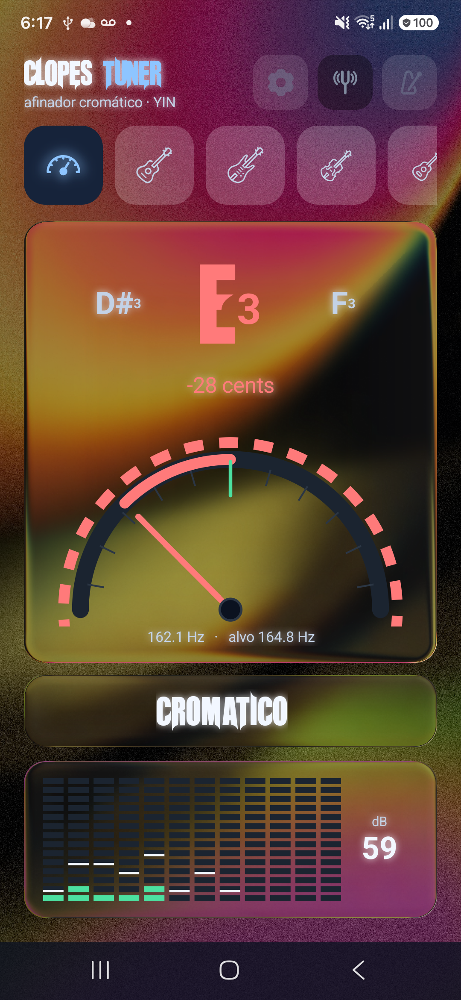
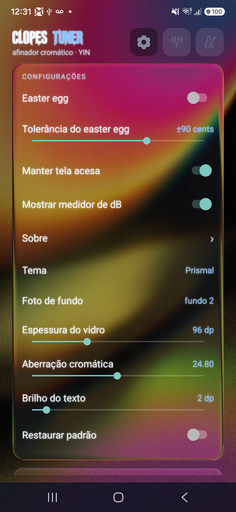

# Clopes Tuner — Prismal

Afinador cromático e metrônomo para Android com **vidro líquido em tempo real**
([Prismal](https://github.com/styropyr0/Prismal), OpenGL ES) sobre foto de fundo.

Variante do [clopes-tuner](https://github.com/ClopesX/clopes-tuner) com efeitos de
glassmorphism: refração, desfoque, aberração cromática e bordas espessas.

<p align="center">
  
  
</p>

## Recursos

- **Afinador cromático** (YIN) com agulha, cents e medidor de dB
- **Metrônomo** com tempo, compasso e sons
- **Tema Prismal**: vidro líquido real (refração, blur, Fresnel, cáusticas)
- **Foto de fundo**: dois fundos inclusos + escolha livre da galeria
- **Ajustes ao vivo**: aberração cromática (0–50), espessura do vidro (0–300 dp),
  brilho do texto (0–24 dp)
- **Glow colorido** nos textos, acompanhando a cor de cada nota
- **6 temas**: Escuro, Vidro, Prismal, Neon, Âmbar, Floresta e Claro
- Sem nuvem, sem anúncios, sem telemetria

## Requisitos

- JDK 17+ (testado com 21)
- Android SDK com a plataforma **36** instalada
- Android 8.0+ (minSdk 26)

## Compilando

```bash
git clone https://github.com/ClopesX/clopes-tuner-prismal.git
cd clopes-tuner-prismal

# informe o caminho do seu SDK
echo "sdk.dir=/caminho/para/o/Android/Sdk" > local.properties

./gradlew assembleDebug
# APK em app/build/outputs/apk/debug/app-debug.apk
```

## Dependências

| Biblioteca | Uso |
|---|---|
| [Prismal](https://github.com/styropyr0/Prismal) 1.0.8 | vidro líquido em OpenGL ES (MIT) |
| AndroidX core / appcompat | base exigida pelo Prismal |
| Compose runtime/ui | dependência transitiva do Prismal |

O repositório `jitpack.io` está declarado em `settings.gradle.kts`.

## Licença

GNU General Public License v3.0 — veja [LICENSE](LICENSE).

O Prismal é distribuído sob MIT; esta aplicação como um todo é GPL-3.0.
